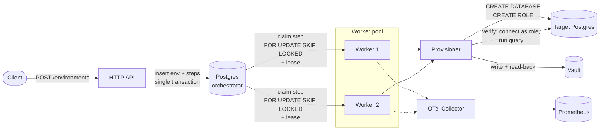
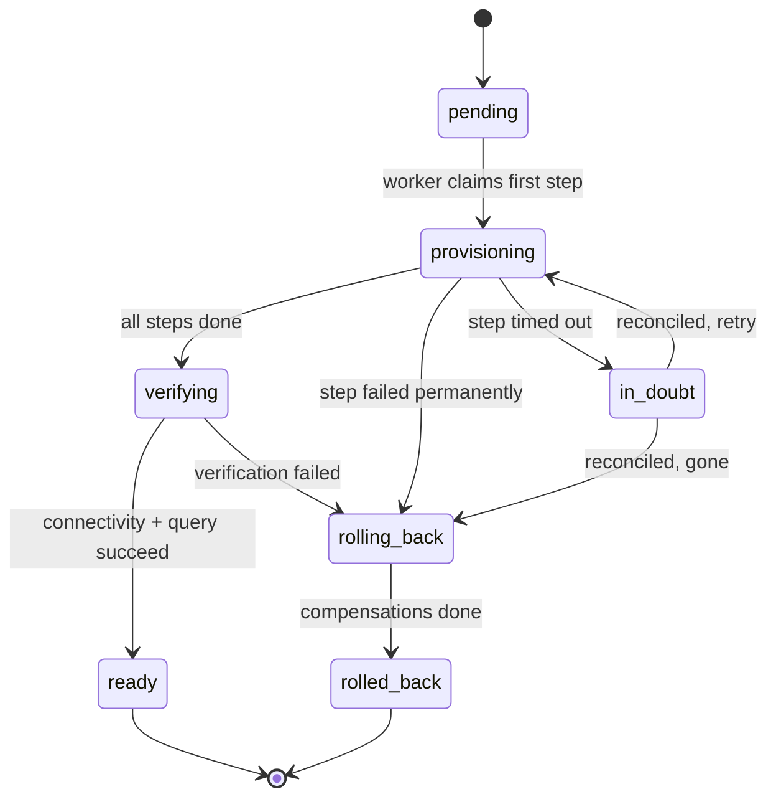

# provisioning-orchestrator

A durable service that provisions isolated team environments — database, least-privilege
access, and credentials stored in Vault — across a sequence of dependent steps, and only
reports an environment as **ready** after proving it is actually usable.

The interesting part is not the provisioning. It is surviving the ways distributed systems
fail mid-provisioning:

| Failure | Naive behaviour | What this service does |
| --- | --- | --- |
| Worker crashes mid-step | Step is lost forever | Lease expires, another worker reclaims the step and re-runs it idempotently |
| Duplicate event delivered | Environment provisioned twice | Step execution is keyed by `(environment, step)` and guarded by a uniqueness constraint |
| Timeout with unknown outcome | Blind retry, resource leak | Step enters `in_doubt`, is reconciled against actual state before any retry |
| Partial failure at step 4 of 6 | Half-built environment left behind | Compensation runs a fixed, dependency-safe cleanup order |
| Everything "succeeded" | Ready, but broken | A verification step connects as the provisioned role and runs a real query |

## Architecture



The state machine per environment:



`ready` is never set optimistically. It is set only when the final step has connected to
the provisioned database **as the provisioned role** and executed a query against it.

## Local setup

Requires Go 1.26+, Docker, and Docker Compose.

```bash
make up          # postgres, vault (dev), otel-collector, prometheus
make run         # start the orchestrator on :8080
curl localhost:8080/healthz
```

| Service | URL |
| --- | --- |
| Orchestrator | http://localhost:8080 |
| Vault (dev, token `root`) | http://localhost:8200 |
| Prometheus | http://localhost:9090 |
| OTLP gRPC ingest | localhost:4317 |

Configuration is environment-driven; every value has a working default for the compose
stack. See [`internal/config/config.go`](internal/config/config.go) for the full list.

```bash
make verify      # gofmt + vet + race tests + build — the gate every change must pass
make down        # tear down and delete volumes
```

## Status

This repository is being built in phases by an autonomous agent loop (one PR per phase,
see [`plan/`](plan/) and [`docs/workflow.md`](docs/workflow.md)). What exists today:

- [x] Module, config, HTTP server with `/healthz` and `/readyz`
- [x] Local dependency stack (Postgres, Vault, OTel, Prometheus)
- [ ] Domain model and provisioning state machine
- [ ] Durable persistence and migrations
- [ ] HTTP API and environment creation
- [ ] Worker pool with lease-based claiming
- [ ] Real provisioning steps and compensation
- [ ] Verification gate
- [ ] Ambiguous-timeout reconciliation
- [ ] Observability
- [ ] Failure-recovery demo

## Design notes

`docs/architecture.md` covers the durability model in detail: why steps are leased rather
than locked, how `in_doubt` differs from `failed`, and what makes each step idempotent.
The normative contract — every state and legal transition, authorization, secret handling,
and the `/v1` surface — is [`docs/design.md`](docs/design.md).
