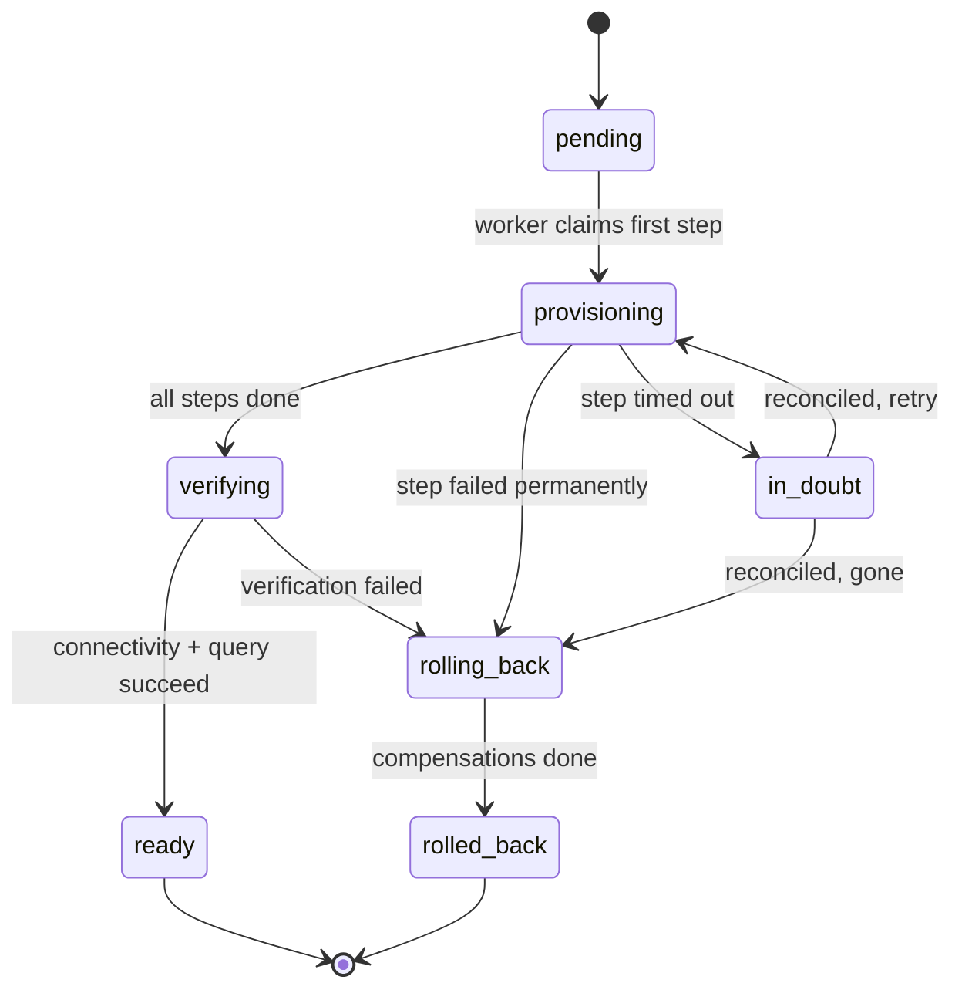

# provisioning-orchestrator

A durable service that provisions isolated team environments — database, least-privilege
access, and credentials stored in Vault — across a sequence of dependent steps, and only
reports an environment as **ready** after proving it is actually usable.

The interesting part is not the provisioning. It is surviving the ways distributed systems
fail mid-provisioning:

| Failure | Naive behaviour | What this service does | Backed by |
| --- | --- | --- | --- |
| Worker crashes mid-step | Step is lost forever | Lease expires, another worker reclaims the step and re-runs it idempotently | `make test-faults` (scenarios 1, 2, 9) |
| Duplicate event delivered | Environment provisioned twice | Step execution is keyed by `(environment, step)` and guarded by a uniqueness constraint | `make test-faults` (scenario 3), `make load` (zero duplicates) |
| Timeout with unknown outcome | Blind retry, resource leak | Step enters `in_doubt`, is reconciled against actual state before any retry | `make test` (worker reconciliation unit tests in `internal/worker`) |
| Partial failure at step 4 of 6 | Half-built environment left behind | Compensation runs a fixed, dependency-safe cleanup order | `make test-faults` (scenarios 4, 5, 7) |
| Everything "succeeded" | Ready, but broken | A verification step connects as the provisioned role and runs a real query | `make test-faults` (scenario 2), `make load` |

Each row's command is reproducible; the measurements and what they *do not*
show are in [`docs/evaluation.md`](docs/evaluation.md).

## Architecture


The state machine per environment:



`ready` is never set optimistically. It is set only when the final step has connected to
the provisioned database **as the provisioned role** and executed a query against it.

## Local setup

Requires Go 1.26+, Docker, and Docker Compose.

```bash
make up          # postgres, vault (dev), otel-collector, prometheus
make run         # start the orchestrator on :8080
curl localhost:8080/healthz
```

| Service | URL |
| --- | --- |
| Orchestrator | http://localhost:8080 |
| Vault (dev, token `root`) | http://localhost:8200 |
| Prometheus | http://localhost:9090 |
| OTLP gRPC ingest | localhost:4317 |

Configuration is environment-driven; every value has a working default for the compose
stack. See [`internal/config/config.go`](internal/config/config.go) for the full list.

```bash
make verify      # gofmt + vet + race tests + build — the gate every change must pass
make test-faults # the ten fault scenarios against the live stack (needs make up)
make load        # the load profile: percentiles + zero-duplicate assertion (needs make up)
make benchmark   # the load profile plus recorded environment context
make down        # tear down and delete volumes
```

Latest recorded local load run: **16/16 environments ready at 4 creates/s with
4 workers**, p50 **160 ms**, p95/p99 **368 ms**, and **0 unexpected or missing
database/role resources**. These are measurements on one 10-core Apple Silicon
host with colocated Postgres 16.15 and dev-mode Vault; see
[`docs/evaluation.md`](docs/evaluation.md) for methodology and limitations.

## Status

What is built today (every claim below is backed by a command; see
[`docs/evaluation.md`](docs/evaluation.md) for the numbers and their limits):

- [x] Module, config, HTTP server with `/healthz` and `/readyz`
- [x] Local dependency stack (Postgres, Vault, OTel, Prometheus)
- [x] Domain model and provisioning state machine (`internal/domain`)
- [x] Durable persistence and migrations (`internal/store`)
- [x] HTTP API: idempotent creation, status/history, cancel/delete
- [x] Worker pool with lease-based claiming and bounded retries
- [x] Real provisioning steps and dependency-safe compensation (`internal/adapters`)
- [x] Verification gate — `ready` only via a completed, proven verification
- [x] Ambiguous-timeout reconciliation (`in_doubt` → verdict, never a guess)
- [x] Observability: metrics, traces, redacted logs, Grafana dashboard
- [x] Failure-recovery demo (`make demo`, `scripts/failure-recovery-demo.sh`)
- [x] Ten fault scenarios asserting persisted **and** external state (`make test-faults`)
- [x] Load profile with time-to-ready percentiles and a zero-duplicates assertion (`make load`)
- [x] Reproducible benchmark recording its environment (`make benchmark`)
- [x] Evaluation and runbook documentation (`docs/evaluation.md`, `docs/runbook.md`)

## Limitations

Stated plainly, because the guarantees above live inside them:

- **Single Postgres.** The orchestrator's store and the provisioned target
  databases are the same instance; there is no independent failure domain.
- **Local adapters.** Capacity, databases, roles, and secrets are local
  implementations against the compose stack — not cloud APIs.
- **At-least-once, not exactly-once.** Steps are re-executed after crashes
  and converge by idempotence; duplicate *executions* are expected, duplicate
  *resources* are not.
- **No multi-region.** One deployment, one lease authority (Postgres `now()`).
- **No general authn/authz.** Caller identity is the `X-Caller-Id` header
  against a static policy; a real identity layer belongs in front of this.

## Design notes

`docs/architecture.md` covers the durability model in detail: why steps are leased rather
than locked, how `in_doubt` differs from `failed`, and what makes each step idempotent.
The normative contract — every state and legal transition, authorization, secret handling,
and the `/v1` surface — is [`docs/design.md`](docs/design.md).
